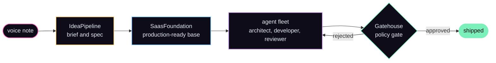

<a href="https://stefankovachev.com"></a>

Full-stack developer in Sofia, Bulgaria. I take web products from idea to production: architecture,
code, infrastructure and the team around it. These days agents do most of the typing; I own the
design, the quality bar and the outcome.

## usage

```console
$ stefan --help
Usage: stefan <command> [options]

Commands:
  build       take a product from idea to production
  architect   design systems that people and agents can build inside safely
  lead        run delivery and grow engineering teams
  automate    turn manual workflows into software, with AI where it earns its place

Options:
  --stack     typescript, react, php, laravel, postgres, supabase, cloudflare
  --mode      ai-first
  --based     sofia, bg (remote-friendly)
```

## how I build now

I rarely write code by hand. I design, specify, orchestrate and review, and agents work inside
guardrails I build.

```diff
- CronMonitor   built by hand        ~24 months
+ LinkLibrary   built with agents     ~1 month
```



## shipped with agents (2026)

| project            | what it is                                                                    | result                             |
| ------------------ | ----------------------------------------------------------------------------- | ---------------------------------- |
| **LinkLibrary**    | Turns any product page into a clean, structured record                        | idea → production in ~1 month      |
| **ChatDashboard**  | Chat with an agent about your data; it builds live dashboard widgets          | ask a question → live dashboard    |
| **RepairDispatch** | AI coordinator from a tenant's message to a booked technician visit           | built in a one-week hackathon      |
| **ImportEngine**   | Messy spreadsheets in, validated records out, delivered to other systems      | messy spreadsheet → clean records  |
| **LocationHub**    | Multi-tenant B2B SaaS with an embeddable map widget                           | one domain, two AI builders        |

<details>
<summary><b>the build system behind them</b></summary>

<br>

- **IdeaPipeline**: a knowledge base where an agent turns rough or spoken ideas into specs a build agent can run.
- **SaasFoundation**: a production-ready starting point for new products, with one set of guidelines synced to seven coding agents.
- **Gatehouse**: configuration as code for a fleet of coding agents, with a policy gate they cannot bypass.

What carries across all of them: deterministic rules make the decisions, models handle the fuzzy
parts, and AI output is validated before anything is saved.

</details>

## toolkit

```yaml
agents:    [claude code, codex, multica]
models:    [openrouter, elevenlabs]
design:    [claude design, lovable]
protocols: [mcp]
process:   [custom skills, phased builds with a review gate, persona-driven agent qa]
```

## changelog

- **2023 →** founder, [cronboard.io](https://cronboard.io): cron monitoring for Laravel, built solo
- **2021 →** lead full-stack developer, [Antero](https://antero.com.au): grew the Bulgarian team from one to four
- **2021 →** team and operations lead, Flip Bulgaria
- **2015 →** senior full-stack developer, [Flip](https://weareflip.com): LMSs, an event platform with live streaming, and Laravel as the company stack
- **2010 →** freelance: 40+ web apps across three continents, mostly under NDA
- **2009** software developer, SAP Labs
- **2007** research, DFKI and Fraunhofer

## elsewhere

[stefankovachev.com](https://stefankovachev.com) · [book a call](https://calendly.com/stefan-kovachev/30min) · [linkedin](https://www.linkedin.com/in/stefankovachev)

<!-- assets/header.svg is generated by `bun scripts/header.ts`. -->
