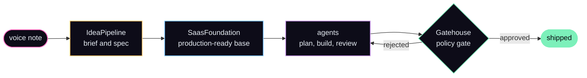

<a href="https://stefankovachev.com"></a>

Senior AI engineer, software architect and full-stack developer in Sofia, Bulgaria. I architect and
build products end to end: the domain model, the boundaries and the infrastructure that keeps it
up. I spec, design and review; agents handle the volume.

## usage

```console
$ stefan --help
Usage: stefan <command> [options]

Commands:
  build       take a product from idea to production
  architect   design systems that people and agents can build inside safely
  lead        run delivery and grow engineering teams
  automate    turn manual workflows into software, with AI where it earns its place

Options:
  --stack     typescript, react, php, laravel, mysql
  --ai        agents, mcp, rag, evals
  --based     sofia, bg (remote)
```

## how I build

I design, specify and review. Agents handle the volume inside guardrails I build, and the result
is mine to answer for.



## shipped

| project            | what it is                                                               | result                            |
| ------------------ | ------------------------------------------------------------------------ | --------------------------------- |
| **LinkLibrary**    | Turns messy web pages into clean, structured records                     | idea → production in ~1 month     |
| **ChatDashboard**  | Ask about your data; an agent builds live dashboard widgets              | ask a question → live dashboard   |
| **RepairDispatch** | AI coordinator from a first message to a booked visit                    | built in a one-week hackathon     |
| **ImportEngine**   | Messy spreadsheets in, validated records out, delivered to other systems | messy spreadsheet → clean records |
| **LocationHub**    | Multi-tenant B2B SaaS with an embeddable map widget                      | one domain, two AI builders       |

Case studies: [stefankovachev.com/ai](https://stefankovachev.com/ai)

<details>
<summary><b>the build system behind them</b></summary>

<br>

- **IdeaPipeline**: a knowledge base that turns rough or spoken ideas into build-ready specs.
- **SaasFoundation**: a production-ready foundation that every new web product starts from.
- **Gatehouse**: a control layer for coding agents, with a policy gate they cannot bypass.

What carries across all of them: deterministic rules make the decisions, models handle the fuzzy
parts, and AI output is validated before anything is saved.

</details>

## changelog

- **2025 →** senior ai engineer
- **2021 →** lead full-stack developer, [Antero](https://antero.com.au): grew the Bulgarian team from one to four
- **2021 →** team and operations lead, Flip Bulgaria
- **2018 →** founder, [cronboard.io](https://cronboard.io): cron monitoring for Laravel, built solo
- **2015 →** senior full-stack developer, [Flip](https://weareflip.com): LMSs, an event platform with live streaming, and Laravel as the company stack
- **2010 →** freelance: 40+ web apps across three continents, mostly under NDA
- **2009** software developer, SAP Labs
- **2007** research, DFKI and Fraunhofer

## elsewhere

[stefankovachev.com](https://stefankovachev.com) · [book a call](https://calendly.com/stefan-kovachev/30min) · [linkedin](https://www.linkedin.com/in/stefankovachev)

<!-- assets/header.svg is generated by `bun scripts/header.ts`. -->
